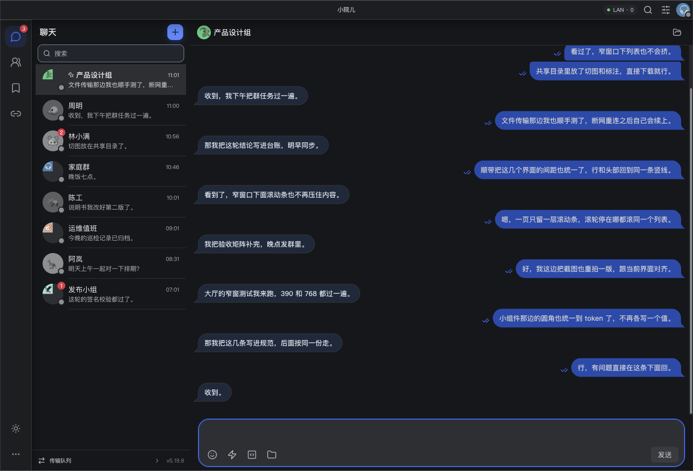
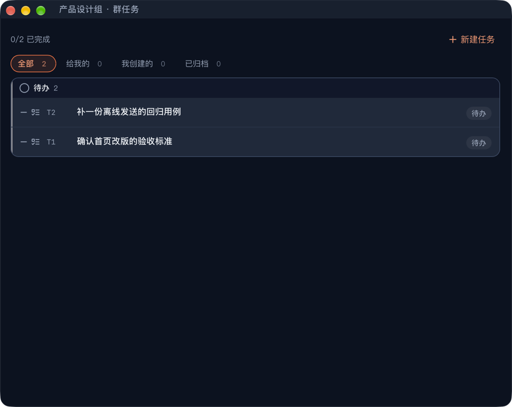
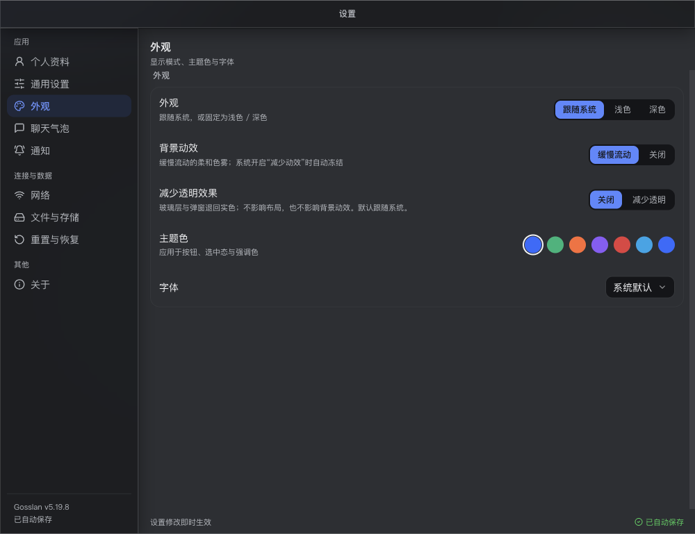

# Gosslan · Serverless LAN messenger

> **English** · [简体中文](README.zh-CN.md)

[](https://github.com/wenzo001/gosslan/releases/latest)
[](https://github.com/wenzo001/gosslan/actions/workflows/verify.yml)
[](LICENSE)

**Chat, share files and run group tasks with people on the same network — no account, no server, no cloud.**

Gosslan discovers peers over UDP multicast/broadcast and Bluetooth, then talks to them directly over
TCP. Messages are end-to-end encrypted and stored only on the devices that sent or received them.



## Why Gosslan

- **No central server.** Discovery and transport are peer-to-peer. Nothing to sign up for, nothing to
  operate. A self-hosted blind relay is optional for cross-CGNAT cases.
- **End-to-end encrypted, always.** X25519 key exchange + Ed25519 identity + ChaCha20-Poly1305.
  There is no switch to turn encryption off.
- **Offline-first delivery.** Every message is written to a local outbox and removed only after an
  acknowledgement. If the peer is offline it stays queued and is resent when the link returns.
- **Files, not just text.** Direct file transfer, group file fan-out, resumable transfers, shared
  folders, images and long-text/code messages.
- **Group workspace.** Group chat, announcements, tasks, pins, reactions, read receipts and recall.
- **Three platforms, one network.** Windows, macOS and Android can all see and message each other,
  over Wi-Fi or Bluetooth LE.

## Platform support

| Platform | Package | Notes |
| --- | --- | --- |
| Windows x64 / ARM64 | `*_x64-setup.exe`, `*_arm64-setup.exe` | Uses the system WebView2; `*-setup-webview2-bundled.exe` embeds a fixed WebView2 for offline or old machines |
| macOS Apple Silicon / Intel | `*_aarch64.dmg`, `*_x64.dmg` | In-app updates use the signed `.app.tar.gz` from the same release |
| Android arm64 / armeabi-v7a | `*-arm64-v8a-release.apk`, `*-armeabi-v7a-release.apk` | No in-app updater; install the new APK over the old one |

Bluetooth LE is included in the official builds on all three platforms.

## Install

Download the file for your platform from [Releases](https://github.com/wenzo001/gosslan/releases/latest).
Version numbers are never copied into this README — the badge above always shows the latest release.

If you cannot reach GitHub, the same installers and APKs are mirrored to
[Gitee releases](https://gitee.com/fwdq/gosslan-releases) — CI copies the release assets
and the update manifest there after every publish.

- **Windows:** run the `setup.exe` and follow the installer.
- **macOS:** open the `.dmg` and drag **Gosslan** into `Applications`.
- **Android:** open the `.apk` and allow installation from the source you chose. Both APK ABIs are
  published; `arm64-v8a` covers most phones from the last decade.

Users do not need the `.sig` files: they are for the desktop updater's signature check.

## Quick start

1. Install Gosslan on two devices on the same Wi-Fi (or near each other with Bluetooth on).
2. Open **Add friend**, pick the other device, and confirm the request on both sides.
3. Start chatting. Text, images, files, group chats and group tasks work without any server.
4. If the other device goes offline, keep typing — messages stay queued and are delivered when it
   comes back.

## Screenshots

| Group tasks | Settings |
| --- | --- |
|  |  |

## Decentralization and privacy

- Messages, keys, contacts and files live in the local SQLite database and the local cache directory.
  There is no cloud backup and no telemetry.
- The network is the local link: same LAN, or Bluetooth LE at short range. There is no default
  cross-subnet reachability; for CGNAT-to-CGNAT cases you can run the optional
  [blind relay](https://github.com/wenzo001/gosslan-relay-server), which forwards ciphertext bytes
  without parsing or storing them.
- On Android, background receiving depends on the LAN channel being on; the ongoing notification
  explains this and lets you stop it. Doze and vendor battery policies can still limit it.
- There is no voice/video calling, no cloud sync and no multi-device history merge. Those are design
  boundaries, not missing checkboxes.

## FAQ

**Do I need an account?** No. Identity is a device key pair; friends are verified by the security
code shown on both profiles.

**Can I turn off encryption?** No. E2EE is always on.

**Does it work across different subnets?** Not by default. Use a routed endpoint or the optional
self-hosted relay.

**How do I update?** Windows and macOS check the signed update manifest in the release. On Android,
install the newer APK.

**Where is my data?** Only on this device, in the app's local data directory. You can export chat
history as a plain Markdown file from Settings → Files & storage.

## Development

Requirements: Node.js 22+ (`.node-version` pins 22.23.2), Rust 1.77+
(`rust-version` in `src-tauri/Cargo.toml`), and the Tauri v2 prerequisites for your platform.

```bash
npm install
npm run tauri dev        # run the desktop app
npm test                 # frontend unit tests
cargo test --features bluetooth   # Rust tests (run inside src-tauri)
```

Build installers with `npm run dist:mac`, `npm run dist:win`, or
`npm run android:build:release`. CI runs the full verification matrix on every push and tag.

Before changing code, read [AI_PROJECT_HANDOFF.md](AI_PROJECT_HANDOFF.md) and
[AI_RULES.md](AI_RULES.md). They describe the architecture, invariants and the required
test/documentation workflow.

## Contributing

Issues and pull requests are welcome. Please keep changes small, include tests for behavior changes,
and keep the documentation in sync. Security-sensitive areas (protocol, crypto, database migrations)
have extra review requirements described in `AI_RULES.md`.

## Design references

The interface follows this repo's own design language — see
[docs/design-language/README.md](docs/design-language/README.md). Its copy tone and
layout discipline were also informed by
[unslop](https://github.com/heydamir/unslop) by Damir Sokolovsky
([@heydamir](https://x.com/heydamir), CC BY 4.0): we used its checklist for the
"AI-generated look" (4px grid, a single accent, hairline borders, no gradient text or
glow, no exclamation marks) and adapted it to Gosslan's glass material. Which criteria
were adopted — and which were deliberately left out — is recorded in
[docs/design-language/sources.md](docs/design-language/sources.md).

## License

[MIT](LICENSE) © 2026 wd.f
