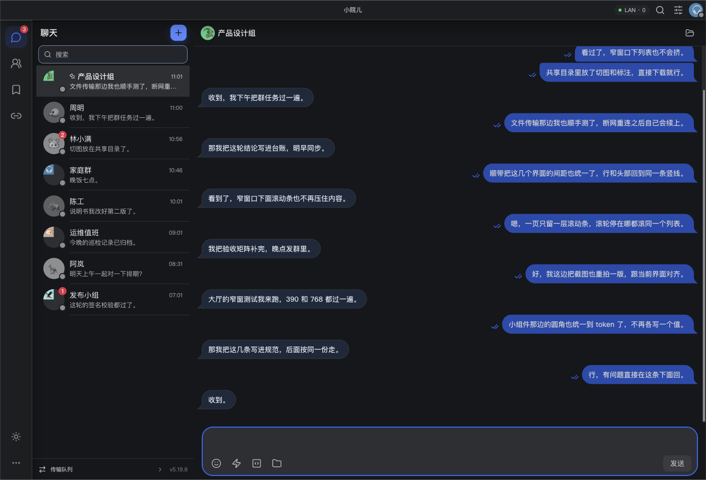
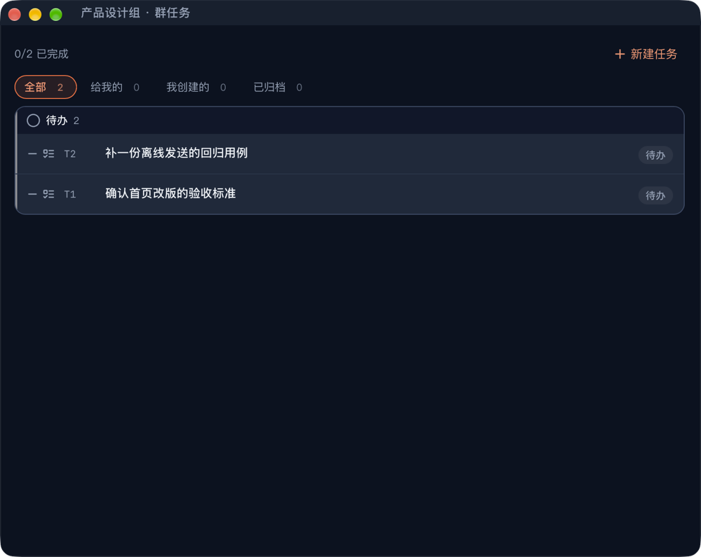
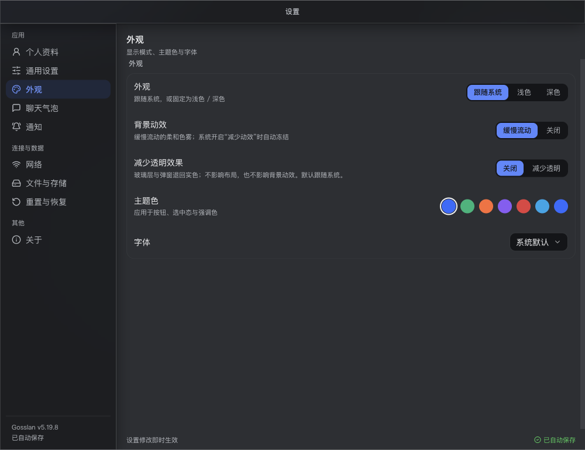

# 小院儿 Gosslan · 无服务器局域网即时通讯

> [English](README.md) · **简体中文**

[](https://github.com/wenzo001/gosslan/releases/latest)
[](https://github.com/wenzo001/gosslan/actions/workflows/verify.yml)
[](LICENSE)

**在同一网络里聊天、传文件、跑群任务——不用注册、不用服务器、不上云。**

小院儿通过 UDP 组播/广播和蓝牙发现附近的设备，再用 TCP 点对点直连。消息端到端加密，
只保存在收发双方的设备上。



## 为什么用它

- **没有中心服务器。** 发现和传输都是点对点，不需要注册，也没有需要运维的服务端。
  跨 CGNAT 时可选择自建一台只搬密文字节的哑管道中继。
- **端到端加密恒开。** X25519 密钥交换 + Ed25519 身份校验 + ChaCha20-Poly1305；
  没有"临时关掉加密"这个开关。
- **离线也能发。** 每条消息先写本机待发队列，收到确认才删行；对方离线时自动排队，
  链路恢复后补发，同一 `msg_id` 不会重复入库。
- **不只是文字。** 单聊/群聊文件、群文件分发、断点续传、共享目录、图片、
  长文本与代码消息。
- **群工作区。** 群公告、群任务、置顶、表情回应、已读回执、撤回。
- **三端同一张网。** Windows、macOS、Android 可以互相发现和收发，走 Wi-Fi 或蓝牙 LE。

## 平台支持

| 平台 | 安装包 | 说明 |
| --- | --- | --- |
| Windows x64 / ARM64 | `*_x64-setup.exe`、`*_arm64-setup.exe` | 使用系统 WebView2；`*-setup-webview2-bundled.exe` 内嵌固定版 WebView2，供老机器/离线环境 |
| macOS Apple 芯片 / Intel | `*_aarch64.dmg`、`*_x64.dmg` | 应用内更新读取同一次发布里的签名 `.app.tar.gz` |
| Android arm64 / armeabi-v7a | `*-arm64-v8a-release.apk`、`*-armeabi-v7a-release.apk` | 不走应用内更新；新版直接覆盖安装 APK |

官方构建在三个平台都带蓝牙 LE。

## 安装

到 [Releases](https://github.com/wenzo001/gosslan/releases/latest) 下载对应平台的文件。
这份 README 不抄版本号——上面的徽章永远是当前发布版本。

GitHub 访问不了时走 [Gitee 镜像](https://gitee.com/fwdq/gosslan-releases)：
每次发布后 CI 会把同一批安装包、APK 和更新清单同步过去。

- **Windows：** 运行 `setup.exe`，按安装器提示下一步。
- **macOS：** 打开 `.dmg`，把 **小院儿 / Gosslan** 拖进「应用程序」。
- **Android：** 打开 `.apk`，允许你所选来源安装即可。两个 ABI 都会发布，
  近十年的手机基本选 `arm64-v8a`。

普通用户不需要 `.sig` 文件：那是桌面端应用内更新的签名校验件。

## 快速上手

1. 在两台同一 Wi-Fi 的设备上安装小院儿（或者打开蓝牙，让设备靠近）。
2. 打开「添加好友」，选中对方设备，双方确认申请。
3. 直接开聊。文字、图片、文件、群聊和群任务都不需要任何服务器。
4. 对方离线也照常输入——消息会排队，等它回来再送达。

## 截图

| 群任务 | 设置 |
| --- | --- |
|  |  |

## 去中心化与隐私

- 消息、密钥、好友与文件都在本机 SQLite 和本地缓存目录里；没有云备份，也不做遥测。
- 网络范围是本地链路：同一局域网，或近距离蓝牙 LE。默认不承诺跨网段可达；
  两侧都在 CGNAT 后面时，可以自建可选的
  [哑管道中继](https://github.com/wenzo001/gosslan-relay-server) —— 它只转发密文字节，
  不解析、不落盘。
- Android 的后台接收依赖局域网通道开着；常驻通知里写清了这条前提，也提供了停止入口。
  Doze 与厂商省电策略仍可能限制网络。
- 没有语音/视频通话，没有云同步与多设备历史合并；这些是设计边界，不是待办清单。

## 常见问题

**需要账号吗？** 不需要。身份是一对设备密钥；好友通过资料页的「安全码」互相核对。

**能关掉加密吗？** 不能，端到端加密恒开。

**跨网段能用吗？** 默认不能。可以用手动端点或自建可选中继。

**怎么更新？** Windows / macOS 走签名更新清单；Android 重新安装新版 APK。

**数据在哪？** 只在这台设备上。设置 →「文件与存储」可以把聊天记录导出成纯 Markdown 文件。

## 开发

需要 Node.js 22+（`.node-version` 钉住 22.23.2）、Rust 1.77+
（`src-tauri/Cargo.toml` 的 `rust-version`），以及对应平台的 Tauri v2 前置依赖。

```bash
npm install
npm run tauri dev        # 启动桌面端
npm test                 # 前端单元测试
cargo test --features bluetooth   # Rust 测试（在 src-tauri 下运行）
```

打包用 `npm run dist:mac`、`npm run dist:win` 或 `npm run android:build:release`。
CI 会在每次 push 和 tag 上跑完整验证矩阵。

改代码前先读 [AI_PROJECT_HANDOFF.md](AI_PROJECT_HANDOFF.md) 与
[AI_RULES.md](AI_RULES.md)：架构、不变量与测试/文档同步流程都在那里。

## 贡献

欢迎提交 Issue 和 Pull Request。请保持改动小、行为变更带测试、文档同步。
协议、加密、数据库迁移属于安全敏感区域，`AI_RULES.md` 里对它们有额外的评审要求。

## 许可证

[MIT](LICENSE) © 2026 wd.f
