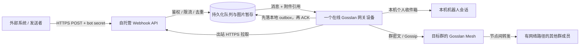

# Gosslan 通知机器人与 Webhook 转发设计

- 状态：设计方案，未实现；供产品与协议评审后拆分开发计划。
- 本次复审补充（2026-11-16）：一个在线 Gosslan 接入设备可从 Webhook 服务取件，再由既有群 Mesh/Gossip 扩散；其他群成员不必连接 Webhook 服务。
- 范围：本机创建、管理和撤销通知机器人；外部系统通过 HTTP 发送文字/图片；自托管服务排队并交付给 Gosslan 客户端；客户端投递到个人机器人收件箱或指定群。
- 非目标：通用自动化平台、任意外链抓取、机器人主动读取聊天记录、远程控制客户端、官方代运营消息服务。
- 代码状态：本次只读审阅并新增本文档，没有修改业务代码。

## 1. 结论与可行性

功能可行。用户补充的“只需一个人连接服务，其他人不必连接也能收到”对**群通知**成立：一个在线的 Gosslan 网关设备从 Webhook 服务取到消息后，将其作为一条群消息发布到现有 Gosslan Mesh/Gossip；有可达路径的群成员由节点间转发接收，不需要各自连接 Webhook 服务。这里的“连接服务”是网关客户端到 Webhook API 的出站取件连接，不是所有群成员都要去连接公网 API。

服务器仍需要修改（或旁边部署一个能与客户端对接的独立 Webhook 服务）：当前 Relay Server 只按通道摘要配对 TCP 并转发字节，不能接收 HTTP webhook、持久排队或把消息交给某个 Gosslan 客户端。推荐给该部署新增独立 Webhook API/队列入口，TCP Relay 保持原样。客户端把消息写入本地持久 outbox 后即可向 Webhook 队列 ACK，再由 Gosslan 负责群内传播；服务器不需要接入群密钥或伪装成 Gosslan 节点。

建议在 `gosslan-relay-server` 增加**独立的 Webhook API 服务和持久化收件队列**，使用独立端口或独立反向代理路由；保留现有 TCP Relay 端口与协议不变。每个 bot 只需一个在线的 Gosslan 网关设备主动建立 HTTPS 拉取连接；其他群设备继续使用 Gosslan 节点间现有连接接收消息，不必访问 Webhook API。外部发送者仅持有一个机器人级发送密钥，不能读取队列、聊天记录或管理其他机器人。

这是去中心化网络里的一个有意例外：外部系统进网和暂存由用户部署的 Webhook 服务承担，进入 Gosslan 后的群内传播仍由节点组成的 Mesh 负责。Webhook 服务会看到消息明文，且网关离线期间会暂存消息与图片；不能沿用盲中继的“读不到内容、不存储内容”表述。

## 2. 现状证据与设计约束

| 证据 | 对方案的影响 |
|---|---|
| `docs/adr/0020-blind-circuit-relay.md`：现 Relay 只做口令准入和字节管道，不解析 Gosslan 帧、不落盘；明确排除 HTTP、邮箱式离线队列 | Webhook 必须作为独立服务/协议增量实现，保留旧 TCP 监听、配置和行为 |
| `src-tauri/src/commands/relay.rs`：当前客户端保存 IPv4 `ip:port`、共享口令；设置用于现有 TCP Relay 拨号 | Webhook 的 HTTPS 地址、机器人 ID 与每机器人凭证需要独立配置和生命周期，不能复用 `relay_token` |
| `src-tauri/src/network/transport/relay.rs`：Relay 电路仅在好友缺少其他路径时建立，接入后复用既有握手和链路读写 | 外部服务不是 Gosslan 好友，不能直接加入这条电路或冒充 `device_id`；需要单独的 webhook 拉取/交付适配层 |
| `src-tauri/src/network/transport/gossip.rs`：群信封经邻居 fan-out；非群成员节点可转发密文但不消费明文；新链路有窗口内群信封补递 | 一个群成员网关发布后，其他 Gosslan 节点可继续经 Mesh 中继；每个成员不需要连 Webhook。此机制是尽力传播，不是全员在线/送达保证 |
| `src-tauri/src/protocol.rs`：协议版本与能力位显式管理；未知帧和消息类型存在跨版本兼容边界 | 如消息最终进入群 Gossip，应定义版本化、能力门控的 bot 来源元数据；不可假设所有旧客户端认识新的消息种类 |
| `src-tauri/src/commands/relay.rs` 与 ADR 说明 relay 准入口令在本机设置中明文保存，且不进入日志/诊断 | 新机器人密钥需更严格地按“可撤销外部凭证”处理：一次性显示、不能进入日志/诊断、可轮换/撤销；不要复用服务器全局 Relay 口令 |

**外部仓库核验边界：** 用户提供的 GitHub 页面在本次检索环境无法读取，因此本文只依据主仓库 ADR 与客户端实现判断现有 Relay 能力。独立服务器当前分支的部署变量、监听器组织、存储引擎、发布方式和可复用代码仍需在实现前对照 `gosslan-relay-server` 的当前 README/源码核实；本文不把未读取的外部实现细节当事实。

## 3. 产品定义

### 3.1 用户心智

“机器人”是一个本机创建的、可撤销的**外部消息入口**，不是有自主聊天能力的 AI，也不代表外部发送者拥有 Gosslan 账号。

用户创建机器人时：

1. 命名机器人并选择投递位置：个人机器人收件箱，或当前设备可访问的一个群。群通知绑定一个“接入网关设备”，通常是创建机器人的本机。
2. 客户端向配置的 Webhook 服务注册该机器人，获得公开 endpoint、机器人 ID 和一次性发送密钥。
3. 用户把 endpoint 与密钥交给外部系统/发送者。接入方以 HTTP POST 发送纯文本和图片。
4. 服务验证、去重并持久排队；一个在线网关客户端取件、先写入本地 outbox，再回 ACK；随后由 Gosslan Mesh 把群消息转发给其他成员。
5. 聊天界面显示机器人名称、外部来源（可选）、收到时间、图片和交付状态。用户可以暂停、轮换密钥或撤销机器人。

### 3.2 目标与不变量

- 一台设备拥有的机器人默认只在该设备配置和收件，不假设 Gosslan 有云账号或跨设备账户同步。
- 外部 Webhook 密钥只允许向一个机器人提交新消息；不能拉取、编辑目标会话、获取群成员或修改机器人设置。
- 外部发件者不被伪装成 Gosslan 好友。界面明确标为“机器人转发”，可显示其提供的来源名，但来源名是未验证文本。
- 服务接受成功 (`202 Accepted`) 只代表**已持久入队**，不代表已到达设备或已发进群。
- Webhook 服务每个 bot 只需一个有效网关客户端取件；群成员无须逐个连接 Webhook 服务。
- 网关确认是在本地持久 inbox/outbox 事务完成后发出；服务确认 ACK 后才删除队列项。网络中断允许重复投递，客户端必须按事件 ID 幂等。
- “发布进群 Mesh”不等于“每个成员都已收到”：离线设备、网络分区、被关闭的转发节点都可能暂时不可达。没有逐成员可靠回执时，产品最多确认“已写入本机发送队列/已发布到 Mesh”，不能承诺全员到达。
- 机器人停止、撤销、服务器不可达、客户端离线、群失效、图片超限、队列满和密钥泄漏都要有可见状态与恢复路径。

## 4. 总体架构



**职责边界：**

- **Webhook API：**外部协议入口、bot 凭证校验、请求限制、幂等接收、持久队列、图片暂存、租约/ACK、状态查询和清理。
- **一个 Gosslan 网关客户端：**创建机器人与目标绑定、保存凭证、保持出站拉取、校验响应、先持久化到本机 inbox/outbox，再确认 Webhook 队列；群投递仍走群密钥加密与 Gossip。它不是所有群成员都要运行的专用云端节点。
- **其他群成员：**不连接 Webhook API；沿用现有 Gosslan peer 连接与 Mesh/Gossip 收到群消息。成员离线或和网关暂时不在同一可达网络分量时，不承诺即时送达。
- 这一点复用的是现有 Gossip 的广播 fan-out 与非成员密文转发：中间节点即使不是该群成员也可转发密文，但不能解密/消费。实际可达仍受连接图、各节点的中继授权策略、TTL、限流和在线状态约束；“去中心化”不等于网络分区时必达。
- **既有 Relay TCP：**继续只提供盲字节转发，不承载 HTTP，也不变成聊天邮箱。
- **外部调用方：**持有一个 bot 级发送密钥；仅能提交消息与查询该次提交的有限状态（若启用状态接口）。

### 4.1 单聊与群聊投递语义

- **个人机器人收件箱（推荐 MVP 默认）：**每个机器人有一个独立的本机收件会话/消息流；不需要伪造一个“自己给自己发的 P2P 消息”，不进入好友关系，也不向其他设备同步。它仍使用聊天消息的文字/图片呈现能力。
- **单聊目标：**只发给 bot 明确绑定的那一个好友/设备，不会像群广播一样让其他节点都收到；若目标离线或暂时不在可达路径上，只能依赖 Gosslan 现有单聊 outbox/重连补发边界。要通知多人，必须选择群目标。
- **群投递（建议 MVP 主路径；需协议评审）：**机器人绑定一个已存在的群与一个网关设备。Webhook 到达后，该网关作为实际 Gosslan 发送设备，把消息封装成带 `source=webhook_bot` 和 `bot_id` 的群消息，经现有群密钥加密/Gossip 传播。其他群成员只需处于 Gosslan Mesh 的可达路径上，无需连接 Webhook 服务。群里显示“机器人名称 · 由设备名代投递”，发送者身份仍是该 Gosslan 设备，不能显示成外部发件人。
- 如果唯一网关设备离线，外部请求仍可在 Webhook 队列排队，但不会立刻进入 Gosslan 群网；网关恢复并取件后才继续。Webhook 服务不是绕过网关、直接把群消息注入 Mesh 的服务器。
- 群被删除、机器人所有者离群、密钥/权限失效时，停止群投递；队列保留到期并在本机显示失败，不能悄悄改投另一个会话。
- 一个 bot 初版只绑定一个投递目标，避免同一密钥被用于多会话广播、误配与授权范围膨胀。需要广播时由用户显式创建多个 bot 或后续做具备确认的多目标规则。

## 5. 外部 HTTP 接口草案

所有外部接口必须 HTTPS。URL 路径只含不可猜测的 bot ID；密钥放 `Authorization` header，不放 query string、路径、日志或 Referer。反向代理应屏蔽/脱敏该 header。

### 5.1 发消息

```http
POST /v1/hooks/{bot_id}/messages
Authorization: Bearer <bot_secret>
Idempotency-Key: <caller-generated-unique-id>
Content-Type: multipart/form-data
```

字段：

| 字段 | 规则 |
|---|---|
| `text` | 可选纯文本；至少提供 text 或一张 image；按 UTF-8 字节限长；不渲染 HTML |
| `source` | 可选来源标签，按文本清理与限长；只显示为未验证来源，不参与身份认证 |
| `image[]` | 可重复图片字段；只接受允许的栅格 MIME；服务检查文件头并重新识别类型；拒绝 SVG/HTML/可执行格式 |
| `Idempotency-Key` | 同 bot 下的去重键；重复提交返回第一次的 event_id/status，不重复入队 |

推荐响应：

```json
{
  "event_id": "evt_...",
  "status": "queued",
  "accepted_at": "2026-11-16T00:00:00Z",
  "status_url": "/v1/hooks/{bot_id}/messages/evt_..."
}
```

状态码：`202` 已入队、`400` 格式/字段错误、`401` 凭证无效/已撤销、`413` 超限、`429` 限流、`503` 队列/存储不可用。`202` 前必须事务性写入事件与附件元数据；无法持久化时不能假成功。

### 5.2 查询投递状态（可选但推荐）

```http
GET /v1/hooks/{bot_id}/messages/{event_id}
Authorization: Bearer <bot_secret>
```

仅返回本 bot 可见的 `queued | accepted_by_gateway | expired` 等 Webhook 队列状态、时间戳和有限错误码。Gosslan 客户端本地另显示 `queued_for_mesh | published_to_mesh`；若未来有可信逐成员 ACK，再单独提供收件人级到达状态。不得把“网关接管”显示为所有群成员已送达；也不得返回客户端 IP、群成员、聊天记录、服务内部路径或其他 bot 信息。

### 5.3 客户端拉取与 ACK

客户端接口使用独立设备签名授权或短时客户端会话凭证；**不能使用外部 webhook secret 作为客户端取件凭证**。

```text
POST /v1/client/bots/{bot_id}/pull   -> 最多 N 个事件 + 租约
POST /v1/client/bots/{bot_id}/ack    -> event_id + durable_receipt
POST /v1/client/bots/{bot_id}/nack   -> event_id + retryable/permanent 分类
POST /v1/client/bots/{bot_id}/heartbeat -> bot/device active + cursor
```

- 客户端每次只取有限批次；服务给事件租约。租约过期未 ACK 时可重投。
- 网关先在 DB 事务中写入事件 ID 唯一约束、收件记录、本机聊天消息/发送 outbox 和附件引用，提交成功后才 ACK。收到重复事件时返回已有 receipt 并再次 ACK，不重复显示或重复 enqueue。
- 群目标下，服务器 ACK 的含义仅为“网关已安全接管”。网关本机发送 outbox 随后重试 Gossip 发布；服务端状态可以显示 `accepted_by_gateway`，客户端状态另显示 `queued_for_mesh / published_to_mesh`。不能把服务端 `delivered` 用作全体成员均收到。
- 服务端状态区分 `queued`（尚未取件）、`leased/fetched`（已取件未 ACK）、`accepted_by_gateway`（已 ACK）、`retry`、`failed`、`expired`。
- 不在同一轮无限重试毒消息；达到尝试次数后转 `failed`，本机界面可重试或删除。

## 6. 消息与附件格式

### 6.1 规范化内部事件

服务接收后转换为固定版本 envelope：

```json
{
  "schema": "gosslan.webhook-message.v1",
  "event_id": "evt_...",
  "bot_id": "bot_...",
  "created_at": "2026-11-16T00:00:00Z",
  "text": "可选纯文本",
  "source": "可选、未验证来源名",
  "images": [
    {"attachment_id": "att_...", "name": "photo.jpg", "media_type": "image/jpeg", "size": 12345, "sha256": "..."}
  ]
}
```

不要接受调用方指定 `sender_id`、`device_id`、`conversation_id`、`group_id`、消息时间戳顺序、信任级别或任意 Gosslan wire frame。目标由 bot 注册配置唯一决定。

### 6.2 图片处理

- MVP 用 multipart 上传图片，避免 Base64 扩大体积；服务端设置单图、总请求、数量、像素和队列总容量上限。
- 校验魔数与 MIME 一致；文件名仅作显示信息并清理路径分隔符/控制字符；客户端展示不自动执行或下载远程 URL。
- 图片写入受限的临时对象存储/本地目录；元数据与队列记录原子关联；写入失败回滚整条 webhook 接收。
- 图片在客户端确认后按保留策略清理服务器副本；到期、撤销 bot、删除事件时清理孤儿附件。
- 不允许服务器按 URL 抓图，避免 SSRF、内网探测和不可控大文件下载。

## 7. 凭证、隐私与滥用边界

### 7.1 凭证生命周期

- 每个 bot 独立生成至少 256-bit 随机密钥；创建/轮换后只显示一次，用户可复制 endpoint 与 secret。
- 服务端只保存带服务端 pepper 的 HMAC/SHA-256 摘要用于比对；任何日志、诊断包、错误响应、分析事件都不包含 secret。
- 支持 `active -> paused -> revoked` 状态。暂停立即拒收新请求但保留队列；撤销立即使旧凭证失效，并依用户选择清空或保留已入队消息至 TTL。
- 轮换提供短暂重叠窗口或立即切换选项；界面明确旧密钥失效时间。泄漏时可以立即 revoke、重新生成并查看最后使用时间/IP 粗粒度摘要。
- 密钥仅授权“向这个 bot 发新消息”，不授权读消息、拉取、改目标、管理 bot 或调用其他 API。

### 7.2 传输、存储与信任声明

- 外部发送者到服务、客户端到服务强制 TLS；公网 HTTP 明文直接拒绝。建议用域名和受信任证书；若只配置 IP，部署方需提供客户端可验证的证书方案，不能静默跳过校验。
- 服务因路由与离线队列必然处理消息明文，并在客户端离线时暂存消息/图片；主仓当前盲 Relay 的“服务器读不到、不存储”承诺不适用于 Webhook 服务。
- MVP 明确采用“TLS 传输保护 + 服务端持久队列”的信任模型：自托管服务运营者可访问队列内容。可选的端到端附件/内容加密放后续阶段，前提是外部调用方能取得 bot 公钥并实现稳定的加密 SDK/格式。
- 服务配置可选队列磁盘加密，但它不能防止运行中的服务进程读取消息，文案不得称为端到端加密。

### 7.3 服务端防护与运维

- 按 bot、来源 IP 和全局维度限速；限制每 bot 队列深度、每日字节数、单次请求大小、图片像素和消息保留天数；限额达到时返回 `429/503` 与可解释错误。
- 只接受固定方法、固定 content type、固定字段；请求体先限流再解析；拒绝压缩炸弹、路径穿越文件名、畸形 JSON/Multipart 和重复超大头。
- 使用事务与唯一索引实现幂等；ACK/租约更新原子化；队列清理可中断并支持重启续跑。
- 健康状态至少公开 readiness（API、存储、队列可写）、队列深度、最旧事件年龄、失败/过期数量、磁盘余量；指标不带正文和密钥。
- 备份/恢复、服务器重启、磁盘满、证书过期、升级回滚都有运维说明；队列不可写时拒绝接收，禁止返回伪成功。

## 8. 完整状态闭环

| 对象/动作 | 状态 | 用户可见行为 | 恢复/终止 |
|---|---|---|---|
| Bot 创建 | `draft -> provisioning -> active / failed` | 显示目标、服务地址、正在创建/失败原因 | provisioning 可取消；失败可重试；重复创建幂等 |
| Bot 运行 | `active <-> paused -> revoked` | 在线、暂停、服务不可达、凭证失效、网关设备离线、已撤销 | 网关恢复后续拉积压；暂停保留积压；撤销不可逆，需新建 |
| 外部提交 | `received -> queued -> leased -> accepted_by_gateway` | 调用方收到 event_id；可查询 Webhook 队列状态 | 网关没 ACK 时过租约重投；本机持久化后 ACK；幂等避免重复 |
| 群转发 | `queued_for_mesh -> published_to_mesh -> (recipient receipts, if available)` | 本机显示“待 Mesh 发送/已发布”；逐成员到达只在有真实回执时展示 | Mesh 暂时不可达时保留本机 outbox 重试；成员离线不阻止接受 webhook，但不假报全员送达 |
| 异常事件 | `retry -> failed / expired` | 客户端任务/机器人面板可见失败计数与错误分类 | 用户重试、删除或调整目标；TTL 到期清理 |
| 附件 | `uploading -> stored -> referenced -> delivered -> purged` | 上传失败、图片不可用或超限有明确反馈 | 事务失败回滚；未引用对象定时清理；到期不可恢复 |
| 目标群 | `valid -> unavailable` | 群已删除/已离群/无密钥时显示暂停投递 | 不自动换目标；用户重新选择并确认新 bot |

通知应默认“有新机器人消息”的低敏摘要，不把外部全文/图片放系统通知；用户可单独配置是否显示预览。外部提供的来源名和内容都视为不可信输入，需做 UI 转义与长度限制。

## 9. 用户界面建议

### 9.1 入口与管理

- 设置 > 网络/集成或聊天侧栏的“机器人”管理页，复用现有 Reka UI 封装、表单、Dialog、Toast、空态和错误态，不另造控件。
- 列表展示名称、投递位置、启用状态、待投递/失败数、最近收到时间、服务连接状态。
- 创建向导按“命名与目标 → 服务/安全提示 → 创建 → 一次性复制 endpoint+secret → 接入示例 → 自测”推进。
- 每个 bot 提供暂停、恢复、轮换密钥、查看队列、重试失败、清理积压和撤销；撤销需说明是否清理队列。
- 可复制最小 curl 和 JSON/multipart 示例，但界面不要把密钥永久回显；复制后也应可显式再生成新密钥。

### 9.2 聊天表现

- 个人机器人会话使用 bot 名称与专属图标，消息气泡标记“Webhook”；收到的 `source` 显示为次级、未验证标签。
- 群中按普通群消息的权限、撤回、未读和历史语义运行，但附加可见来源标记；真实发送设备可追溯，不能混淆为外部发送者账号。
- 图片作为普通图片附件显示，遵循现有图片预览/缓存机制；附件哈希校验失败展示可恢复占位，不显示破图静默状态。
- 发送到群失败时，消息保留在网关本机待投递台账，展示“等待 Mesh 发送/发布失败”；Webhook 服务可在网关持久接管后 ACK，但不能因此丢弃网关本机 outbox。
- 群成员收到与否由 Gosslan Mesh 负责；机器人面板默认只显示服务入队、网关接管和 Mesh 发布三段状态。无可靠逐成员回执时，不显示“所有成员已送达”。

## 10. 分阶段落地计划

### Phase 0：服务器契约与威胁模型（先做）

1. 在 `gosslan-relay-server` 当前主线核实运行方式、现有监听器、配置、日志、可用持久存储与部署/升级流程；确认一个 Gosslan 网关即可取件，其他成员通过群 Mesh 收消息。
2. 选择独立 Webhook listener/反向代理形状，确定 TLS 终止、队列存储、图片文件布局、容量、TTL、备份和密钥轮换；不得让服务器持有群密钥或伪装为群成员。
3. 固化 OpenAPI/JSON Schema、错误码、幂等、pull/lease/ACK、bot 注册授权、隐私声明和兼容策略；与主仓协议 fixture/契约测试联动。
4. 用原型验证单机多客户端、服务重启、重复 POST、客户端断线、磁盘满与 ACK 丢失的状态闭环。

**退出条件：**确认服务器可以维护稳定队列；一个在线网关能取件并持久接管；网关发布路径复用既有群加密/Gossip；其他成员无需连 Webhook 服务；管理 API 有可靠的设备所有权证明/配额边界；HTTPS/TLS 部署可用；所有数据保留与隐私文案已定。若无法解决 bot 注册权限和队列持久化，不进入客户端 UI 阶段。

### Phase 1：单网关群通知 MVP（推荐）

1. Relay Server 新增独立 `/v1` Webhook API、bot 注册/撤销、外部 POST、幂等队列、附件限制、单网关拉取租约与 ACK；现有 TCP port 线格式 fixture 保持逐字节不变。
2. Gosslan 客户端加入 bot CRUD、一次性 secret 展示、暂停/轮换/撤销、单网关出站 pull worker 与可观测运行状态。
3. bot 绑定现有群时，网关 DB 事务创建 bot event 唯一记录与 Gosslan 消息 outbox；成功持久化后 ACK 服务，再由既有群加密/Gossip 对群传播。其他群成员无须配置 Webhook。
4. 首批优先群通知；个人机器人收件箱作为同一收件/展示管线的本机目标，可同时或随后落地，不伪造成 self-DM。
5. 做集成验证：外部 POST → 服务入队 → 单网关取件 → 本地持久化+群 outbox → ACK → 网关经 Mesh 发布 → 另一群成员收到；覆盖其他成员完全未配置 Webhook、网关离线积压、网络分区、服务/客户端重启与重复提交。

### Phase 2：群传播闭环与兼容增强

1. 评估 Phase 1 的 `webhook_bot` 来源元数据在旧客户端上的降级显示；依据 ADR-0007 与 `CONTENT_FEATURE_*` 决定是否需要能力门控或可选字段，不伪造新 sender 身份。
2. 完善服务已 ACK、网关本机 outbox、Gossip fan-out、邻居补递之间的状态映射和诊断；记录 webhook event 到 Gosslan message id 的映射。
3. 如用户需要逐成员确认，再设计 recipient receipt；在此之前明确 UI/外部状态只到 `published_to_mesh`，不承诺全员到达。
4. 验证老客户端行为、未知字段降级、撤回/未读/历史同步、群成员变更、节点网络分区与中继授权关闭的边界。

### Phase 3：运维成熟与扩展

1. 加入队列监控/管理、备份恢复演练、限额面板、租户隔离（如未来服务器托管）和可观测审计。
2. 评估端到端加密 envelope、外部发送 SDK 与可选签名来源校验；不阻塞 MVP，也不把 TLS 等同于 E2E。
3. 评估多设备收件、多个目标、多 bot 规则和官方托管服务；每项都需独立产品与安全评审。

## 11. 工作区影响面预估（实现阶段）

| 仓库/模块 | 预期变化 |
|---|---|
| `gosslan-relay-server` | 必须增加独立 HTTP(S) Webhook API listener（或与其并列部署独立服务）、bot/credential 存储、消息与附件队列、单网关租约/ACK/TTL、限额/指标/配置/部署说明、契约与故障注入测试；现有 TCP Relay 仍不变 |
| `src-tauri/src/commands/` | bot 注册/读取/暂停/轮换/撤销、单网关 pull/ACK 客户端命令、可信签名授权与事件映射 |
| `src-tauri/src/db/` | bot 配置/事件幂等/本地 outbox/收件消息与附件台账；事务和迁移计划 |
| `src-tauri/src/protocol.rs` / `network/` | 若支持群投递，定义兼容元数据和能力门控；验证签名、群加密、Gossip 与消息身份不变量 |
| `src/stores/` / `src/api/` | bot 生命周期与异步任务状态、乐观更新/回滚、轮询续接、窗口事件与失败恢复 |
| `src/components/` / i18n | 机器人管理页/创建向导/收件会话/失败状态；zh-cn 与 en-us 同步；优先用 Reka UI 现有封装 |
| `docs/` | 更新 API 合约、隐私说明、运维手册、协议不变量、架构图与 release 验收矩阵 |

最终文件归属需实现前按 `docs/domains.data.mjs` 与 `docs/migration-ledger.md` 复核；这里是计划影响面，不是修改授权。

## 12. 风险清单与处置

| 风险 | 严重度 | 处置 |
|---|---:|---|
| 把 webhook API 放入现有盲 Relay listener，造成协议/隐私承诺混淆 | 高 | 独立 listener/端口/反代路径，保持原 TCP fixture 不变 |
| 服务器接收明文与图片却沿用“中继看不到/不存储”文案 | 高 | 在设置、创建向导、部署文档明确服务器可读且暂存；提供 TTL/删除策略 |
| 外部密钥泄漏导致任意人持续灌消息/图片 | 高 | bot scoped 高熵密钥、哈希存储、限流/配额、立即撤销、只读一次、队列上限 |
| API 返回 202 但进程崩溃前未持久化 | 高 | 仅事务提交后返回 202；故障注入验证磁盘满/进程崩溃 |
| ACK 丢失导致重复消息，或过早 ACK 导致消息丢失 | 高 | 事件 ID 唯一约束；DB commit 后 ACK；租约和 at-least-once 语义 |
| 群投递假冒外部用户，或绕过群权限/加密链路 | 高 | 实际发送者仍为 Gosslan 设备；显式来源标记；走现有加密/Gossip 与群权限 |
| 旧客户端解析新群消息失败 | 高 | 可选字段与 capability gate；旧端 fixture 和历史版本兼容验证 |
| 大图片耗尽服务磁盘或客户端内存 | 中高 | multipart 流式写入、大小/像素/队列配额、客户端限制解码尺寸、TTL 清理 |
| 客户端离线过久造成无限积压 | 中 | 每 bot 队列深度/字节上限；可见过期策略；满载拒绝而非吞消息 |
| HTTP 调用任意 URL 导致 SSRF | 中 | MVP 不做 URL 抓取；图片只允许上传字节 |
| 用户认为消息会在所有自己的设备收到 | 中 | 明确机器人默认设备本地；多设备分发列后续项目 |

## 13. 验收清单

- [ ] 原有 Relay TCP 端口、协议 fixture、好友中继与既有路径行为不变。
- [ ] 服务不可用/队列满/磁盘满时，外部请求明确失败，不返回假 `202`。
- [ ] 同一 `Idempotency-Key` 重发只产生一条 event；并发重复提交也只有一个事件。
- [ ] 客户端断线、服务重启、ACK 丢失、租约超时后，事件最终送达且聊天中不重复。
- [ ] 仅一个网关客户端配置并连接 Webhook API 时，有可达 Gosslan Mesh 路径的其他群成员能经现有 Mesh 收到消息，不要求它们知道 Webhook 地址或密钥。
- [ ] 网关在 HTTP 队列 ACK 后掉线时，本机持久 outbox 恢复发送；群成员离线/网络分区时不谎报全员送达。
- [ ] bot 暂停拒收、轮换使旧 key 按定义失效、撤销之后所有旧 URL/key 都失效。
- [ ] 外部 key 不能读取事件内容、队列或聊天；不能改变 bot 目标、枚举 bot_id 或横向访问其他 bot。
- [ ] 文本/图片格式、请求体、像素、数量、磁盘占用与速率边界均有失败态和服务端判据。
- [ ] 个人 bot 收件箱可离线重启恢复；群投递仅由绑定设备发出并沿用群加密与权限。
- [ ] 外部 `source`、文件名、文字不能注入 HTML、路径或假造 Gosslan 身份。
- [ ] 日志、诊断包、错误响应、事件与崩溃信息都不包含密钥或消息正文。
- [ ] 设置中清晰说明自托管服务可读取并暂存内容，显示过期/清理规则。
- [ ] 桌面与移动端创建/复制/失败/恢复界面一致且可操作；中英 locale 文案键对称。
- [ ] 服务端重启、队列恢复、数据备份恢复、证书失效、过期清理与版本回滚有操作手册并完成演练。

## 14. 本次核验与未验证事项

- 已核对主仓盲中继 ADR、`commands/relay.rs`、`network/transport/relay.rs` 和 `protocol.rs` 的职责/兼容边界。
- 本次补核 `src-tauri/src/network/transport/gossip.rs`：群 Gossip 对邻居 fan-out，非群成员可转发密文但不消费；因此单网关发布后可以走既有 Mesh，但依然是受可达路径和在线状态约束的尽力传播。
- 已尝试访问用户给出的 Relay Server GitHub 页面，但检索工具未能读取该仓库；具体实现复用点、配置名和部署方式均标为待 Phase 0 核实。
- 未运行测试或真机验证；本文是产品/架构设计，不是实现完成报告。
- 未修改业务代码。
